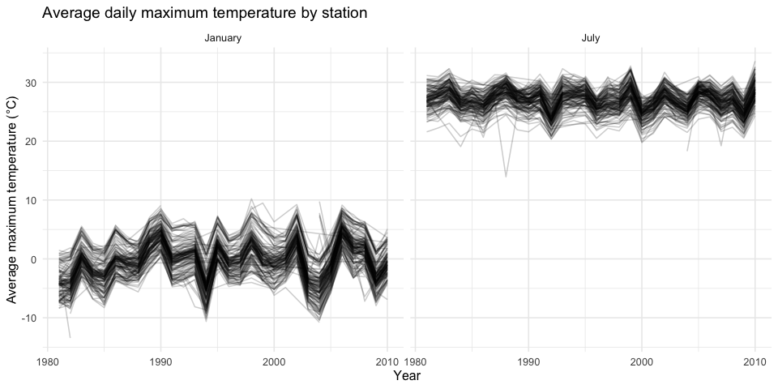
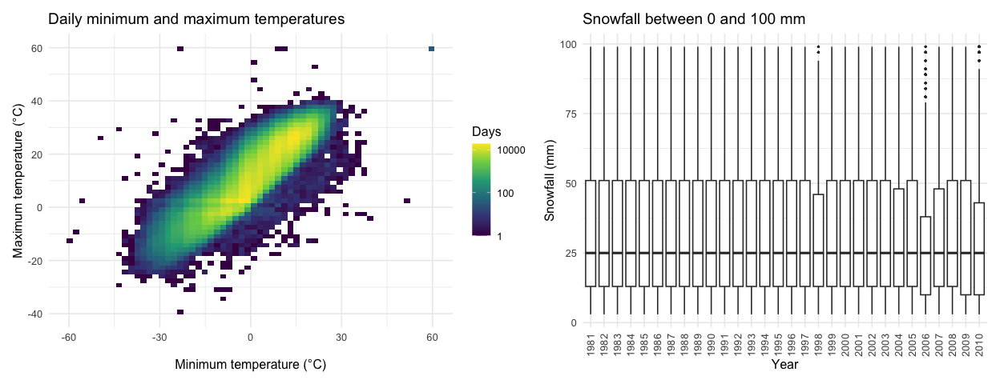
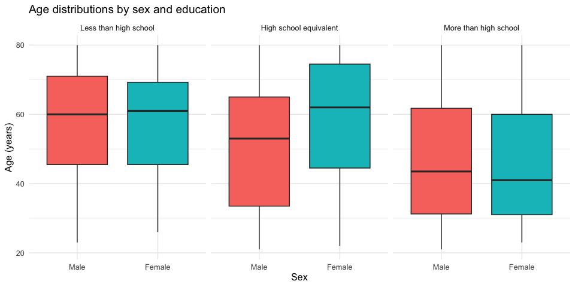
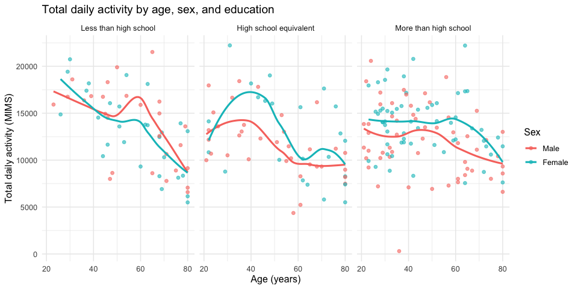
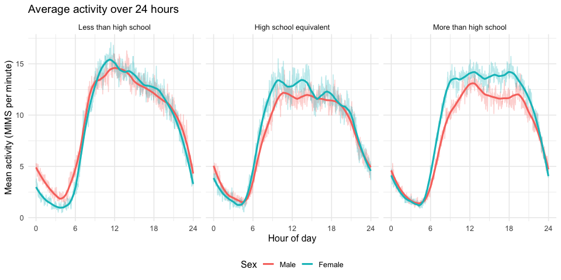
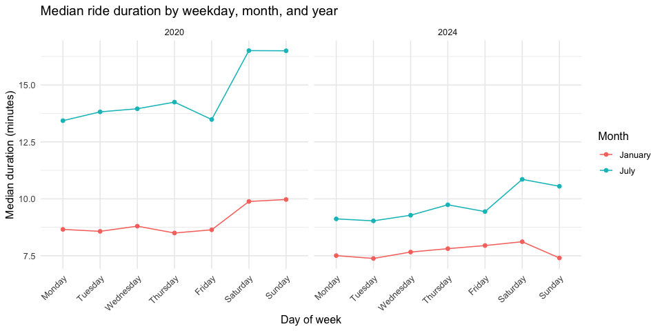
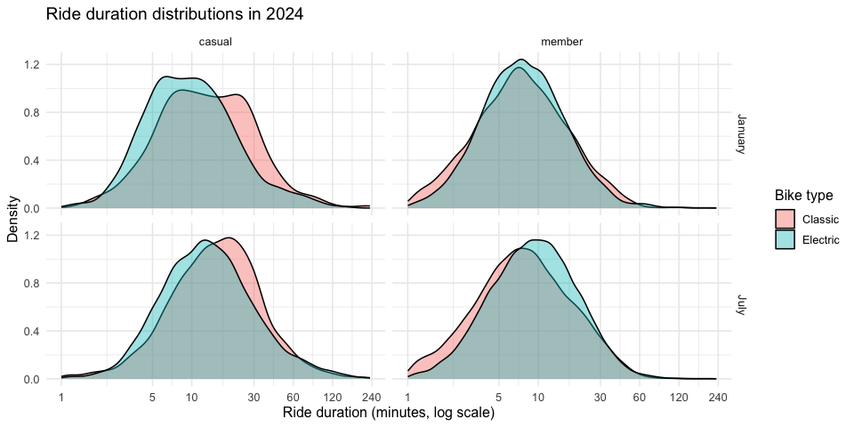

Homework 3
================
Bowen Yao

``` r
library(tidyverse)
library(janitor)
library(p8105.datasets)
library(patchwork)

knitr::opts_chunk$set(fig.width = 10, fig.height = 5)
theme_set(theme_minimal(base_size = 12))
```

## Problem 1

``` r
data("ny_noaa")

weather = ny_noaa |>
  mutate(
    year = year(date),
    month = month(date),
    day = day(date),
    tmax = as.numeric(tmax) / 10,
    tmin = as.numeric(tmin) / 10,
    prcp = prcp / 10
  )

weather |>
  summarise(across(prcp:tmin, ~ mean(is.na(.x)) * 100)) |>
  pivot_longer(everything(), names_to = "Variable", values_to = "Missing (%)") |>
  knitr::kable(digits = 2)
```

| Variable | Missing (%) |
|:---------|------------:|
| prcp     |        5.62 |
| snow     |       14.69 |
| snwd     |       22.80 |
| tmax     |       43.71 |
| tmin     |       43.71 |

The original dataset contains 2595176 rows and 7 columns, with daily
observations from 747 New York weather stations during 1981–2010. Each
row represents a station and date. Variables include station ID, date,
precipitation, snowfall, snow depth, and max/min temperature. I created
separate year, month, and day variables, converted temperatures to
degrees Celsius and precipitation to millimeters, and kept snowfall and
snow depth in millimeters. Missings number is significant: about 44% of
temperature values are missing, compared with about 6% of precipitation
values. The available observations therefore differ across variables,
stations, and dates.

``` r
weather |>
  filter(!is.na(snow)) |>
  count(snow, sort = TRUE) |>
  slice_head(n = 10) |>
  knitr::kable(col.names = c("Snowfall (mm)", "Observations"))
```

| Snowfall (mm) | Observations |
|--------------:|-------------:|
|             0 |      2008508 |
|            25 |        31022 |
|            13 |        23095 |
|            51 |        18274 |
|            76 |        10173 |
|             8 |         9962 |
|             5 |         9748 |
|            38 |         9197 |
|             3 |         8790 |
|           102 |         6552 |

Zero is the most common snowfall value, with 2,008,508 observations. The
next most common values are 25, 13, and 51 mm. Zero is common because
most station-days have no snowfall. The frequent positive values are
approximately one inch, half an inch, and two inches, suggesting that
rounding and conversion from measurements in inches contribute to the
observed pattern.

``` r
monthly_temperature = weather |>
  filter(month %in% c(1, 7)) |>
  group_by(id, year, month) |>
  summarise(mean_tmax = mean(tmax, na.rm = TRUE), .groups = "drop") |>
  filter(!is.na(mean_tmax)) |>
  mutate(month = factor(month, levels = c(1, 7), labels = c("January", "July")))

ggplot(monthly_temperature, aes(x = year, y = mean_tmax, group = id)) +
  geom_line(alpha = 0.2) +
  facet_wrap(~ month) +
  labs(
    title = "Average daily maximum temperature by station",
    x = "Year", y = "Average maximum temperature (°C)"
  )
```

<!-- -->

July is consistently warmer than January. Stations often rise and fall
together across years, suggesting shared annual weather patterns, while
differences between stations may reflect location and elevation. January
shows greater year-to-year variability. There is an unusually low July
average temperature around 1988, approximately 14°C. Such unusual
averages merit checking the underlying observations and the number of
available days.

``` r
temperature_plot = weather |>
  filter(!is.na(tmin), !is.na(tmax)) |>
  ggplot(aes(x = tmin, y = tmax)) +
  geom_bin_2d(bins = 60) +
  scale_fill_viridis_c(trans = "log10") +
  labs(
    title = "Daily minimum and maximum temperatures",
    x = "Minimum temperature (°C)", y = "Maximum temperature (°C)",
    fill = "Days"
  )

snowfall_plot = weather |>
  filter(snow > 0, snow < 100) |>
  ggplot(aes(x = factor(year), y = snow)) +
  geom_boxplot(outlier.size = 0.4) +
  labs(
    title = "Snowfall between 0 and 100 mm",
    x = "Year", y = "Snowfall (mm)"
  ) +
  theme(axis.text.x = element_text(angle = 90, hjust = 1, vjust = 0.5))

temperature_plot + snowfall_plot
```

<!-- -->
Minimum and maximum temperatures have a strong positive association.
Most observations form a diagonal band, with few extreme values away
from the main concentration. The snowfall distributions are broadly
similar across years, with larger snowfall amounts forming the upper
tail. There is no obvious steady increase or decrease in the typical
amount within this restricted range. These distributions exclude zero
snowfall and amounts of 100 mm or more, so they do not describe annual
snowfall totals or how often snow occurs.

## Problem 2

``` r
demographics = read_csv(
  "data/nhanes_covar.csv", skip = 4, show_col_types = FALSE
) |>
  clean_names() |>
  drop_na() |>
  filter(age >= 21) |>
  mutate(
    sex = factor(sex, levels = c(1, 2), labels = c("Male", "Female")),
    education = factor(
      education, levels = c(1, 2, 3),
      labels = c("Less than high school", "High school equivalent", "More than high school")
    )
  )

accelerometer = read_csv("data/nhanes_accel.csv", show_col_types = FALSE) |>
  clean_names() |>
  pivot_longer(
    cols = starts_with("min"),
    names_to = "minute", names_prefix = "min",
    names_transform = list(minute = as.integer), values_to = "mims"
  )

nhanes = inner_join(demographics, accelerometer, by = "seqn")
```

I skipped the four introductory rows in the demographic file,
standardized column names, excluded participants younger than 21 or with
missing demographic information, and labeled sex and education as
factors. I reshaped the activity measurements into minute and MIMS
columns and joined the datasets by participant ID. All original
demographic variables and minute-level activity measurements are kept
for eligible participants. The final dataset contains 228 participants
and 328320 rows, with 1,440 minute-level observations per participant.

``` r
participants = nhanes |>
  distinct(seqn, sex, age, bmi, education)

participants |>
  count(education, sex) |>
  pivot_wider(names_from = sex, values_from = n) |>
  knitr::kable(col.names = c("Education", "Men", "Women"))
```

| Education              | Men | Women |
|:-----------------------|----:|------:|
| Less than high school  |  27 |    28 |
| High school equivalent |  35 |    23 |
| More than high school  |  56 |    59 |

``` r
ggplot(participants, aes(x = sex, y = age, fill = sex)) +
  geom_boxplot() +
  facet_wrap(~ education) +
  labs(title = "Age distributions by sex and education", x = "Sex", y = "Age (years)") +
  guides(fill = "none")
```

<!-- -->

The more than high school category is the largest, with 56 men and 59
women. The less than high school category has similar numbers of men and
women (27 and 28), while the high school equivalent category has more
men than women (35 versus 23). Participants with more than a high school
education tend to be younger. In the high school equivalent category,
women have a higher median age than men, while median ages are more
similar between sexes in the other two categories.

``` r
total_activity = nhanes |>
  group_by(seqn, sex, age, bmi, education) |>
  summarise(total_activity = sum(mims), .groups = "drop")

ggplot(total_activity, aes(x = age, y = total_activity, color = sex)) +
  geom_point(alpha = 0.6) +
  geom_smooth(method = "loess", se = FALSE) +
  facet_wrap(~ education) +
  labs(
    title = "Total daily activity by age, sex, and education",
    x = "Age (years)", y = "Total daily activity (MIMS)", color = "Sex"
  )
```

    ## `geom_smooth()` using formula = 'y ~ x'

<!-- -->

Total activity generally declines with age, although there is
significant variation between participants. The decline is more
pronounced in the less than high school group. Differences between men
and women vary by age and education, so neither sex has consistently
higher activity across all groups. The smooth curves are less reliable
near the age extremes, where fewer observations are available.

``` r
activity_by_minute = nhanes |>
  group_by(education, sex, minute) |>
  summarise(mean_mims = mean(mims), .groups = "drop") |>
  mutate(hour = (minute - 1) / 60)

ggplot(activity_by_minute, aes(x = hour, y = mean_mims, color = sex)) +
  geom_line(alpha = 0.3) +
  geom_smooth(method = "loess", span = 0.2, se = FALSE) +
  facet_wrap(~ education) +
  scale_x_continuous(breaks = c(0, 6, 12, 18, 24), limits = c(0, 24)) +
  labs(
    title = "Average activity over 24 hours",
    x = "Hour of day", y = "Mean activity (MIMS per minute)", color = "Sex"
  ) +
  theme(legend.position = "bottom")
```

    ## `geom_smooth()` using formula = 'y ~ x'

<!-- -->

In all education categories, activity is lowest overnight, increases in
the morning, remains elevated during the daytime, and declines in the
evening. Men and women have broadly similar daily timing. Differences in
activity level depend on the time of day and education category rather
than showing one consistent gap throughout the day. These are group
averages and do not represent every participant’s individual pattern.
Women with more than a high school education tend to have higher daytime
activity than men in that category.

## Problem 3

``` r
citibike = bind_rows(
  read_csv("data/citibike/Jan 2020 Citi.csv", show_col_types = FALSE) |>
    mutate(year = 2020, month = "January"),
  read_csv("data/citibike/July 2020 Citi.csv", show_col_types = FALSE) |>
    mutate(year = 2020, month = "July"),
  read_csv("data/citibike/Jan 2024 Citi.csv", show_col_types = FALSE) |>
    mutate(year = 2024, month = "January"),
  read_csv("data/citibike/July 2024 Citi.csv", show_col_types = FALSE) |>
    mutate(year = 2024, month = "July")
) |>
  mutate(
    year = factor(year),
    month = factor(month, levels = c("January", "July")),
    weekdays = factor(
      weekdays,
      levels = c("Monday", "Tuesday", "Wednesday", "Thursday", "Friday", "Saturday", "Sunday")
    ),
    member_casual = factor(member_casual, levels = c("casual", "member")),
    rideable_type = factor(
      rideable_type, levels = c("classic_bike", "electric_bike"),
      labels = c("Classic", "Electric")
    )
  )
```

The combined dataset contains 99485 rides and 9 variables. Each row is
one sampled ride, with ride ID, bike type, weekday, duration in minutes,
starting and ending station, membership status, year, and month. I added
year and month from the file names, combined the four files, and encoded
categorical variables with meaningful ordering. The files contain a 1%
sample of rides lasting less than four hours in January and July of 2020
and 2024.

``` r
citibike |>
  count(year, month, member_casual) |>
  pivot_wider(names_from = member_casual, values_from = n) |>
  knitr::kable(col.names = c("Year", "Month", "Casual rides", "Member rides"))
```

| Year | Month   | Casual rides | Member rides |
|:-----|:--------|-------------:|-------------:|
| 2020 | January |          984 |        11436 |
| 2020 | July    |         5637 |        15411 |
| 2024 | January |         2108 |        16753 |
| 2024 | July    |        10894 |        36262 |

Members account for more rides than casual riders in every year-month
combination. Both groups have more rides in July than January and more
rides in 2024 than in the corresponding month of 2020. July 2024 has the
largest number of sampled rides.

``` r
citibike |>
  filter(year == "2024", month == "July", !is.na(start_station_name)) |>
  count(start_station_name, sort = TRUE) |>
  slice_head(n = 5) |>
  knitr::kable(col.names = c("Starting station", "Rides"))
```

| Starting station         | Rides |
|:-------------------------|------:|
| Pier 61 at Chelsea Piers |   163 |
| University Pl & E 14 St  |   155 |
| W 21 St & 6 Ave          |   152 |
| West St & Chambers St    |   150 |
| W 31 St & 7 Ave          |   146 |

``` r
median_duration = citibike |>
  group_by(year, month, weekdays) |>
  summarise(median_duration = median(duration), .groups = "drop")

ggplot(median_duration, aes(x = weekdays, y = median_duration, color = month, group = month)) +
  geom_line() +
  geom_point() +
  facet_wrap(~ year) +
  labs(
    title = "Median ride duration by weekday, month, and year",
    x = "Day of week", y = "Median duration (minutes)", color = "Month"
  ) +
  theme(axis.text.x = element_text(angle = 45, hjust = 1))
```

<!-- -->

Median rides are longer in July than in January and shorter in 2024 than
in 2020 for the same month and weekday. Weekend rides tend to be longer,
especially in July. January 2024 shows a weaker weekend pattern, with
Sunday having a relatively short median duration. July 2020 has the
longest medians, reaching about 16.5 minutes on the weekend.

``` r
citibike |>
  filter(year == "2024") |>
  ggplot(aes(x = duration, fill = rideable_type)) +
  geom_density(alpha = 0.4) +
  scale_x_log10(breaks = c(1, 5, 10, 30, 60, 120, 240)) +
  facet_grid(month ~ member_casual) +
  labs(
    title = "Ride duration distributions in 2024",
    x = "Ride duration (minutes, log scale)", y = "Density", fill = "Bike type"
  )
```

<!-- -->

On the original minutes scale, ride durations are right-skewed, with
many short trips and a long tail of longer trips. The log axis makes the
distributions easier to compare without excluding long rides. Casual
riders generally take longer rides than members, and July rides tend to
last longer than January rides. Among casual riders, classic-bike rides
have a higher median duration than electric bike rides in both months.
Among members, electric bike rides have a slightly higher median in
January and a more noticeably higher median in July. These comparisons
describe associations in the sample rather than causal effects.
